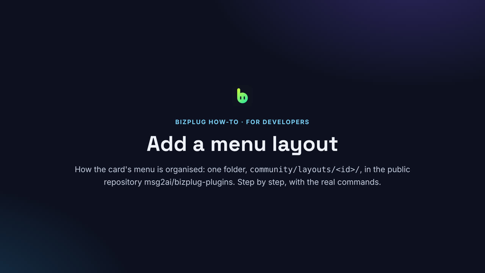

# Menu layouts

A BizPlug plug-in shows a card in ChatGPT and Claude. Its **menu layout** decides how the menu is organised and how people move through it; the options, forms and results are the same in every layout. A business picks a layout on its plug-in's page in the [BizPlug portal](https://www.bizplug.ai/portal), with a live preview of its own card next to the standard layout, on a computer and on a phone. Plug-ins show their layout from version 0.31.0. See them live on [www.bizplug.ai/layouts](https://www.bizplug.ai/layouts).

Layouts are open source. This page is also how to build one.

## The layouts

6 layouts. Each name opens the layout's package: its code, its description and two pictures of it on a sample business, on a computer (680 px) and on a phone (390 px). To see one on a real card next to the standard layout, use [www.bizplug.ai/layouts](https://www.bizplug.ai/layouts).

| Layout | What it is | Suits | By | Pictures |
|---|---|---|---|---|
| [Tiles](layouts/grid/) (standard) | Your banner and name, a highlighted Start here tile, then every option as a tile in two columns. The layout every card has had so far. | Any business with four to eight options. | [BizPlug](https://www.bizplug.ai) | [computer](layouts/grid/preview-desktop.png), [phone](layouts/grid/preview-mobile.png) |
| [App](layouts/app/) | A phone-app home: your banner with your logo on its edge, a row of round quick actions, a big Start here card and the questions people often ask, with a tab bar for your three main destinations and More. | Businesses customers come back to, with two or three clear jobs: hotels, restaurants, gyms, coworking, salons, members' clubs and chambers. | [BizPlug](https://www.bizplug.ai) | [computer](layouts/app/preview-desktop.png), [phone](layouts/app/preview-mobile.png) |
| [Ask bar](layouts/ask/) | A large Ask or search bar with suggested questions under it, and every option in one compact list that filters as people type. Enter opens the first match; anything else is asked in the chat. | Businesses people come to with a question, or with many options: chambers, software, clinics, professional services, guides. | [BizPlug](https://www.bizplug.ai) | [computer](layouts/ask/preview-desktop.png), [phone](layouts/ask/preview-mobile.png) |
| [Christmas](layouts/christmas/) | The Tiles menu dressed for the holidays: a string of twinkling lights, gentle snow over your name and banner, a holly sticker, bauble icons and a snowy edge. Motion stops for people who turn it off on their device. | Any business for December: shops, markets, cafés, bakeries, restaurants, hotels and holiday events. Switch back to your usual layout in January. | [BizPlug](https://www.bizplug.ai) | [computer](layouts/christmas/preview-desktop.png), [phone](layouts/christmas/preview-mobile.png) |
| [Event](layouts/event/) | The menu of the Qatar Event Show 2026 card: your picture across the top with a coloured rule and a dark title strip under it, your event's dates, hours and venue, then the agenda with one button per day, the other options in two columns, and wide buttons to ask a question, continue on WhatsApp and contact you. Without an agenda, three large buttons for what people ask first. | Events, shows and conferences, venues, chambers and any business with a wide picture and a few clear things to do. | [msg2ai](https://www.msg2.ai) | [computer](layouts/event/preview-desktop.png), [phone](layouts/event/preview-mobile.png) |
| [Story](layouts/story/) | A magazine-style page: a cover with your picture, your name and the Start here action, a row of chapters, then each option as a numbered chapter with large artwork, its example question and an Ask this button. | Brands with strong pictures and a story to tell: hotels and resorts, venues, tourism, events, restaurants, and chambers presenting their programmes. | [BizPlug](https://www.bizplug.ai) | [computer](layouts/story/preview-desktop.png), [phone](layouts/story/preview-mobile.png) |

## Build a layout

A layout is a folder: `community/layouts/<id>/` for yours, `layouts/<id>/` for the ones that come with the website:

| File | What it holds |
|---|---|
| `layout.json` | `id` (the folder's name: lower-case letters, digits, hyphens), `name`, `author` (`name`, optional https `url` and GitHub username `github`, which the credit on www.bizplug.ai/contributors links to), `summary`, `suits`, and `ownHeader`: `true` when your layout draws the business's name, logo and banner itself (the card then leaves out its own header); optional `sample`: the BizPlug sample business your layout is shown with first, `hospitality/demo-hotel`, `coffee-shops/demo-cafe` or `retail/demo-shop`, so a shop layout is previewed on the sample shop. |
| `layout.js` | One function, `function render(ctx) { ... }`, that returns the menu as an HTML string. |
| `layout.css` | Its styles. Every selector starts with `.lay-<id>`: the card puts your HTML in `
">`. |
| `preview-desktop.png`, `preview-mobile.png` | Pictures of your layout at 680 and 390 px wide (from `preview.ts`, below). |

Start from [layouts/_template/](layouts/_template/), and read [layouts/ask/](layouts/ask/) for a complete one.

### What `render(ctx)` gets

| Field | What it is |
|---|---|
| `ctx.business` | `engine` (how the plug-in works: stay, order, appt, quote or track; a hotel is `stay`), `span` (for a stay: nights, days or single), `name`, `subtitle`, `logo` (an address or null), `logoWide` (the logo has the name in it), `banner` (an address or null; it may have text in the picture, so show it whole, about 1.91 to 1, and never put the name over it), `initials` (for when there is no logo). |
| `ctx.options` | The menu, in order: `index` (use it with `data-open`), `kind` (lookup, request, question, status, contact, members, news, committees, social and others), `title`, `short` (one word, for tabs and round buttons), `description`, `example` (a question a customer might ask), `icon` (an SVG, ready to insert), `start` (true for the first option: the one to start with). |
| `ctx.contact` | BizPlug's own contact links (`title`, `description`, `whatsapp`, `email`), or null. The card already shows them under the menu; you need not. |
| `ctx.actions` | The business's own buttons, in order: `key` (whatsapp, a booking page, directions, a social network and the like), `label`, `href` (an https address; use it with `data-href`). Empty when it has none. |
| `ctx.event` | For an event guide (a show or conference that published its agenda), else null: `when` ("1 to 3 September 2026"), `past` (true once it has taken place), `hours`, `venue` (each may be empty) and `days` (`date` as YYYY-MM-DD and `label` such as "Tue 1 Sep"; use the date with `data-aday`). |
| `ctx.ui` | Your layout's own state, set with `data-lay` (below): for example the open tab. Strings only. |
| `ctx.mode` | `"dark"` or `"light"`. |
| `ctx.h(text)` | Escapes text for HTML. Use it on every text and attribute value you put in your HTML. |
| `ctx.icon(name)` | An SVG icon: spark, enter, home, more, arrow, chev, close, calendar, bed, social, question, request, lookup, status, members, contact, committees, news, mail, whatsapp, store. |

### How your layout does things

A layout never runs code of its own in the card: `render` is called again whenever something changes, and returns new HTML. Everything people do goes through these attributes, which the card handles:

| Attribute | What the card does |
|---|---|
| `data-open="<index>"` | Opens that menu option: its form or its results. |
| `data-ask="<text>"` | Sends the text to the chat as the customer's question. |
| `data-href="https://…"` | Opens the address (with the host's permission). |
| `data-aday="YYYY-MM-DD"` | Opens an event guide's agenda on that day (one of `ctx.event.days`). |
| `data-lay="key:value"` | Sets `ctx.ui[key]` to `value` and draws your layout again; an empty value clears it. Several at once with `;`: `data-lay="tab:3;more:"`. For tabs, panels and "show more". |
| `data-lay-filter` (on an `<input>`) | A search box. As people type, the card hides the elements with `data-lay-text` that do not contain every word typed (put lower-case text in it), without drawing again, so the box keeps its focus. ↑ and ↓ move the highlight (class `lay-sel`), Enter opens the highlighted element, Escape clears. |
| `data-lay-count` | Shows "N of M match" while people type, and its `data-lay-count-idle` text otherwise. |
| `data-lay-ask-row` with `data-ask=""` | Shown while people type, to ask what they typed in the chat; elements inside it with `data-lay-query` show the words. |
| `data-lay-askbtn` | A button next to the search box: asks what was typed, or opens the first row. |

### The rules

`check-layout.ts` checks all of them:

- `layout.js` starts with `function render(ctx)`, and uses no `document`, `window`, events, timers, `fetch` or other network access, `eval`, imports or template literals. Join strings with `+`.
- What it returns has no `<script>`, inline event handlers (`onclick=` and the like) or `javascript:` addresses. The card removes them anyway, with forms, frames and styles.
- `layout.css` scopes every selector under `.lay-<id>`, names every `@keyframes` `lay-<id>-<name>`, and uses no `@import`, no `url()` other than `data:` addresses, and no `position: fixed`.
- At most 24,000 characters of JavaScript and 16,000 of CSS.

### Design notes

- **Colours.** Use the card's colour tokens, so your layout wears every business's colours and works in dark and light mode: `--a1` and `--a2` (the accents), `--ink` (text on an accent), `--bg`, `--fg` (text), `--muted`, `--card`, `--card2`, `--line`, `--glow`, and `--atext` (an accent colour that stays readable as text in light mode). Colour themes are made separately: see [THEMES.md](THEMES.md).
- **Icons.** `ctx.icon()` and each option's `icon` are line icons, 20 px, drawn in the text colour; size them with your own CSS.
- **Size.** The card has 18 px of padding around your layout, and is about 680 px wide on a computer and 360 to 420 px on a phone. It grows with its content and does not scroll inside itself, so a bar fixed to the bottom of the screen or a scroll-linked effect does not work; put a tab bar at the end of your layout, open a panel in place, and keep it short enough for a chat.
- **Motion.** CSS animations are fine (`@keyframes lay-<id>-<name>`); keep them gentle, and stop them under `@media (prefers-reduced-motion: reduce)`. The card draws your layout again when something changes, so an animation starts over then. [layouts/christmas/](layouts/christmas/) has falling snow, twinkling lights and stickers drawn as `data:` SVG.
- **Pictures.** The card shows images only from BizPlug's own site, which is where `ctx.business.logo` and `banner` already point. Draw anything else with CSS or SVG.
- **People.** Make every control a `<button>` or a link, at least 40 px tall to tap, with a visible focus.

### Try it and contribute it

**Watch it step by step** (1:20, no sound): [play it on the how-to page](https://www.bizplug.ai/how-to/developers/add-theme-layout-industry#add-a-menu-layout), or [download the video](assets/videos/add-a-menu-layout.mp4). It shows every command below and what it prints.

1. Copy `layouts/_template/` to `community/layouts/<your-id>/`, and set the same `id` in `layout.json` and in every `.lay-<id>` selector. The rest of `layouts/` is generated from the BizPlug website on every release; `community/` is kept as you wrote it.
2. `npx tsx layouts/preview.ts community/layouts/<your-id>` writes an HTML page per sample business and mode: open them and resize the window to 680 and 390 px. It uses this repository's copy of the card (`layouts/card.html`) and the sample businesses in `layouts/samples/`.
3. Take the two preview pictures: the sample hotel at 680 px in dark mode (`preview-desktop.png`) and the sample café at 390 px (`preview-mobile.png`).
4. `npx tsx layouts/check-layout.ts community/layouts/<your-id>`.
5. Open a pull request against `main` that adds only `community/layouts/<your-id>/`, and fill in its checklist with the check's output. The **Check contributions** workflow runs the same check. Not on GitHub? Use the [Propose a menu layout](https://github.com/msg2ai/bizplug-plugins/issues/new?template=menu-layout.yml) form instead, with a link to your folder.

We review a layout on real cards, in ChatGPT and Claude, in dark and light mode, on a computer and a phone, and may suggest changes in the pull request. Once approved, it is merged and stays in this repository, credited to you. Within about fifteen minutes it is listed in the [BizPlug marketplace](https://www.bizplug.ai/marketplace) and on https://www.bizplug.ai/layouts, checked again on every read, with no release: the three featured layouts are offered on every business's plug-in, and any other once a business adds it from the marketplace. The layouts listed above are the ones that come with the website; [https://www.bizplug.ai/layouts](https://www.bizplug.ai/layouts) lists every layout on offer.
