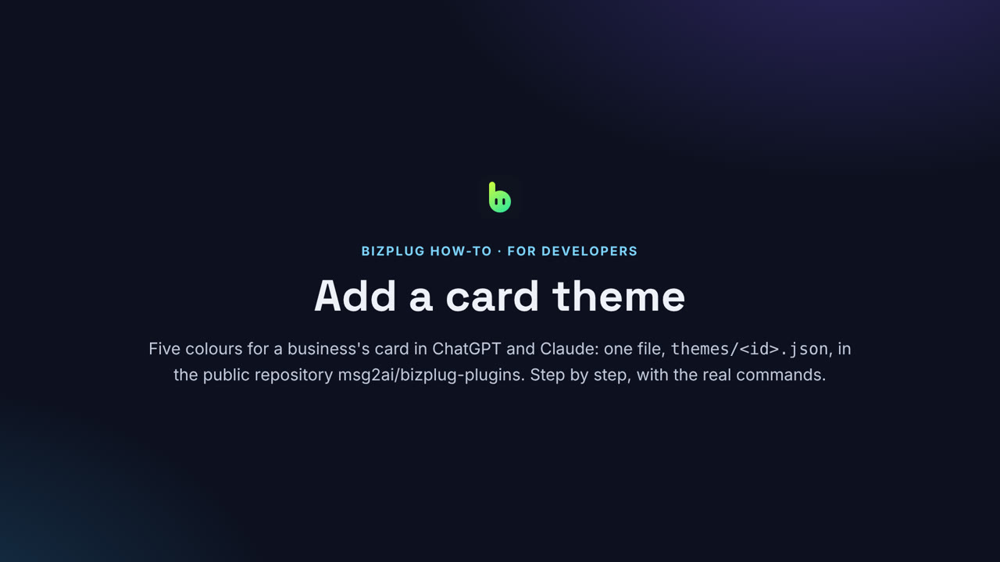

# Card themes

A BizPlug plug-in shows its menu, forms and results in ChatGPT as a **card**. A card theme sets the card's colours, and may decorate it with bands, stickers and motion. A business picks one in the BizPlug portal when it adds a plug-in, or later on its plug-in's page; without one, the card uses the standard look (soft grey on dark navy), or the business's own colours. A theme changes only the colours, never what the plug-in does, so it works on every plug-in version. The industry-wide plug-ins keep BizPlug's own colours.

This page is generated with the rest of the repository, so please do not edit it by hand. The theme files in `themes/` are the exception: that is where a new theme is added (below).

## The themes

| Theme | id | The look | By | Colours | Decorations |
| --- | --- | --- | --- | --- | --- |
| [Ocean](themes/ocean.json) | `ocean` | Cyan to blue on deep navy. Calm and clear: travel, wellness, marine and professional services. | BizPlug | `#67e8f9` → `#60a5fa` on `#071a2b` | None |
| [Sunset](themes/sunset.json) | `sunset` | Amber to coral on a warm dark plum. Friendly and lively: restaurants, cafés, bakeries and events. | BizPlug | `#fcd34d` → `#fb7185` on `#1c1016` | None |
| [Forest](themes/forest.json) | `forest` | Leaf green to teal on dark pine. Fresh and natural: gardens, outdoor, health and sustainable brands. | BizPlug | `#86efac` → `#2dd4bf` on `#0b1a14` | None |
| [Orchid](themes/orchid.json) | `orchid` | Pink to violet on deep indigo. Bold and stylish: beauty, fashion, nightlife and creative studios. | BizPlug | `#f0abfc` → `#a78bfa` on `#140f24` | None |
| [Belgium](themes/belgium.json) | `belgium` | Yellow to soft red on black, after the flag of Belgium. For cafés, chocolatiers, events and tourism bureaus there. | Bart Cant - Rethink Labs | `#fde047` → `#f87171` on `#0d0d0d` | Header and footer bands, 2 stickers, animated |
| [Christmas](themes/christmas.json) | `christmas` | Holly red to pine green on a dark fir background. Festive for December: shops, markets, bakeries, cafés and holiday events. | Bart Cant - Rethink Labs | `#f87171` → `#4ade80` on `#0c1a12` | Header and footer bands, 2 stickers, animated |
| [Jamaica](themes/jamaica.json) | `jamaica` | Gold to green on black, after the flag of Jamaica. For resorts, tours, restaurants and tourism bureaus there. | Bart Cant - Rethink Labs | `#fde047` → `#4ade80` on `#0b0f0a` | Header, divider and footer bands, 1 sticker, animated |
| [Mexico](themes/mexico.json) | `mexico` | Green to off-white on deep red, after the flag of Mexico. For restaurants, hotels, tours and tourism bureaus there. | Bart Cant - Rethink Labs | `#4ade80` → `#f5f5f4` on `#2a0c0c` | Header and footer bands, 1 sticker, animated |
| [Noir Gold](themes/noir-gold.json) | `noir-gold` | Pale gold to antique gold on near-black. Quiet and premium: fine dining, jewellers, luxury hotels and law firms. | Bart Cant | `#fde68a` → `#d4a24c` on `#121110` | None |
| [Qatar](themes/qatar.json) | `qatar` | Off-white to rose on deep maroon, after the flag of Qatar. For hotels, events and tourism bureaus there. | Bart Cant - Rethink Labs | `#f8eef1` → `#f0a3b8` on `#240812` | Header and footer bands, 1 sticker, animated |
| [Qatar Sports](themes/qatar-sports.json) | `qatar-sports` | Yellow-green on carbon with Qatar's maroon and a finish-line band, in a slanted sports style. For sports calendars, clubs, races and venues. | Bart Cant - Rethink Labs | `#d4ff3a` → `#e2ff7a` on `#0c0e11` | Header, divider and footer bands, sport style |
| [South Carolina Beaches](themes/south-carolina-beaches.json) | `south-carolina-beaches` | Atlantic teal to sea-oat sand on deep indigo, with the palmetto-flag crescent. For beach rentals, resorts and seafood spots on the South Carolina coast. | Bart Cant - Rethink Labs | `#5eead4` → `#fcd9a8` on `#0b1626` | Header, divider and footer bands, 2 stickers, animated |
| [USA](themes/usa.json) | `usa` | Soft red to sky blue on deep navy, after the flag of the United States. For businesses and tourism bureaus there. | Bart Cant - Rethink Labs | `#fca5a5` → `#93c5fd` on `#0a1a3a` | Header, divider and footer bands, 3 stickers, animated |

Each theme is in `themes/<id>.json`. The built-in ones are also in [`source/card-themes.ts`](source/card-themes.ts); the others were added here by pull request, and the BizPlug portal and plug-in server read them from this repository's `main` branch.

## What a theme is

A theme is five colours, the ones the card reads, and optionally decorations (below) (see [`source/widgets/plugin-widget.ts`](source/widgets/plugin-widget.ts)):

| Key | What it colours | Format |
| --- | --- | --- |
| `a1` | Start of the accent gradient: buttons, icon tiles, badges | `#rrggbb`, lower case |
| `a2` | End of the accent gradient, and the colour of links and of a focused field's border | `#rrggbb`, lower case |
| `ink` | Text and icons drawn on the accent | `#rrggbb`, lower case |
| `bg` | The card's background in ChatGPT's dark mode (light mode uses white) | `#rrggbb`, lower case |
| `glow` | A soft light in the card's corner | `rgba(r,g,b,alpha)`, alpha .25 or less |

With them, a theme has an `id` (2 to 24 lower-case letters or hyphens, never `business`, and not one already used), a `name` (up to 24 characters), a one-sentence `description` of the look and the kind of business it suits (up to 160 characters), and an `author`: the name or company it is credited to. Optionally add `authorUrl` (your own https link, a site or a profile) and `github` (your GitHub username): the credit in the portal and on [www.bizplug.ai/contributors](https://www.bizplug.ai/contributors) then links to you. Everything in the file is public.

```json
{
  "id": "ocean",
  "name": "Ocean",
  "description": "Cyan to blue on deep navy. Calm and clear: travel, wellness, marine and professional services.",
  "author": "BizPlug",
  "colors": {
    "a1": "#67e8f9",
    "a2": "#60a5fa",
    "ink": "#06121f",
    "bg": "#071a2b",
    "glow": "rgba(103,232,249,.14)"
  }
}
```

## Decorations (optional)

A theme may also decorate the card with `decor`: a band above the content (`header`), a thin divider under the business's name (`divider`), a band below the content (`footer`) and up to three `stickers` in the top corner. They show on every screen of the card. A theme carries no code, no CSS and no image: it names patterns, shapes and motions from the lists below, and the card draws them.

```json
"decor": {
  "header": { "pattern": "stripes", "colors": ["#000000", "#fdda24", "#ef3340"] },
  "divider": { "pattern": "dots", "colors": ["#ffffff"], "motion": "twinkle" },
  "footer": { "pattern": "stripes", "colors": ["#000000", "#fdda24", "#ef3340"] },
  "stickers": [{ "shape": "star", "color": "#fde047", "motion": "twinkle" }]
}
```

| Part | Fields |
| --- | --- |
| A band (`header`, `divider`, `footer`) | `pattern`: `stripes`, `lines`, `serrated`, `dots`, `slant` (stripes side by side, lines stacked, a serrated edge of the first colour over the second, a row of dots, or slanted bands like a finish line). `colors`: 1 to 5 lower-case `#rrggbb` colours (exactly 2 for `serrated`). `motion`, optional: `shimmer`, `twinkle` |
| A sticker | `shape`: `star`, `heart`, `diamond`, `circle`, `leaf`, `sun`; or `path`: your own outline as SVG path data on a 24 by 24 grid (letters, digits, spaces, commas, dots and minus signs, up to 1500 characters). `color`: one `#rrggbb` colour. Optional: `line` (true draws the outline as a line), `large` (true draws it larger) and `motion`: `twinkle`, `float`, `spin`, `flow`, `walk` (`flow` moves along a line; `walk` crosses the top of the card) |

`decor` may also name a `style` for the card's own shapes: `sport` (slanted tabs and tags, titles in upper-case italics, a scoreboard date on events).

Motion stops for people who turn motion off on their device. A sticker you draw must be your own drawing: no logos, coats of arms or official emblems.

## The rules

- **Readable.** Text on the accent and the accent on the background need a contrast of at least 4.5 (WCAG AA): `ink` on `a1` and on `a2`, and `a1` and `a2` on `bg`. In practice: a dark `ink`, bright accents, and a dark `bg`.
- **Your own.** Not another company's brand colours used without permission, and no logos or names of brands in the theme's name.
- **Different.** Clearly different from the themes above.
- **Described honestly.** The description says what the colours are and who they suit, nothing more.

## Add a theme

Theme files are the one part of this repository you change directly: add your theme with a pull request.

[](https://www.bizplug.ai/how-to/developers/add-theme-layout-industry#add-a-card-theme)

**Watch it step by step** (1:04, no sound): [play it on the how-to page](https://www.bizplug.ai/how-to/developers/add-theme-layout-industry#add-a-card-theme), or [download the video](assets/videos/add-a-card-theme.mp4). It shows every command below and what it prints.

1. Write your theme as `themes/<id>.json`, in the format above and named after its `id`. Copy one from `themes/` to start.
2. Check it, from the root of a copy of this repository: `npx tsx themes/check-theme.ts themes/<id>.json`. It runs the same check BizPlug runs and prints what to fix, or the contrast of each pair.
3. See it on the real card: `npx tsx themes/preview.ts themes/<id>.json` writes the sample businesses' cards in your colours, in dark and light mode, and prints where. Open them in a browser at about 680 and 390 px wide and take a screenshot.
4. Open a pull request that adds only that file, with your screenshot. The **Check card themes** workflow runs the same check on it.
5. The BizPlug team looks at it on real cards, in dark and light mode, and may suggest changes in the pull request.
6. Once it is merged into `main`, the theme is listed in the [BizPlug marketplace](https://www.bizplug.ai/marketplace) within about fifteen minutes, with no release needed (the three featured themes are offered on every business's plug-in, any other once a business adds it), and it is listed on this page after the next update. Removing the file removes it from the portal: a business that picked it gets its standard look again.

Not on GitHub, or prefer not to open a pull request? Use the [Propose a card theme](https://github.com/msg2ai/bizplug-plugins/issues/new?template=card-theme.yml) form instead, with the JSON and the check's output, and the team adds the file for you.

Everything else in this repository is generated from the BizPlug website, so a theme's pull request changes nothing outside `themes/<id>.json`. Plug-ins and menu layouts are contributed by pull request too, in `community/`: see [Contribute](README.md#contribute-plug-ins-themes-and-layouts).

Questions: info@bizplug.ai.
